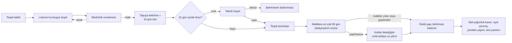
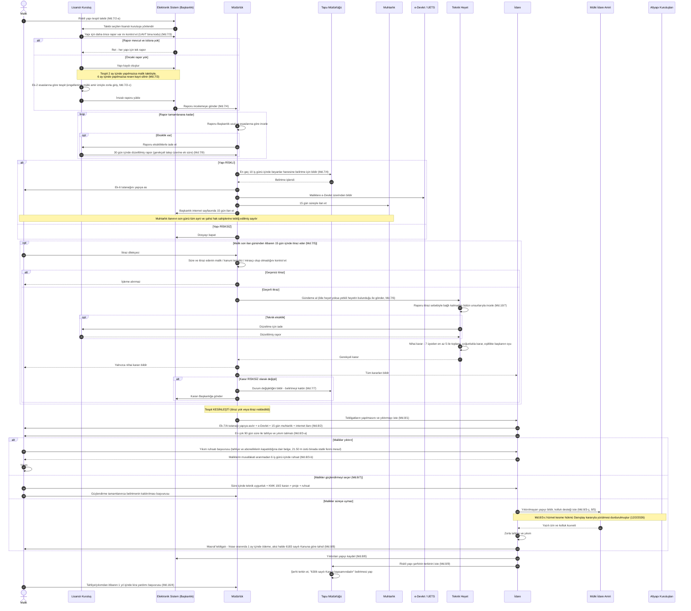
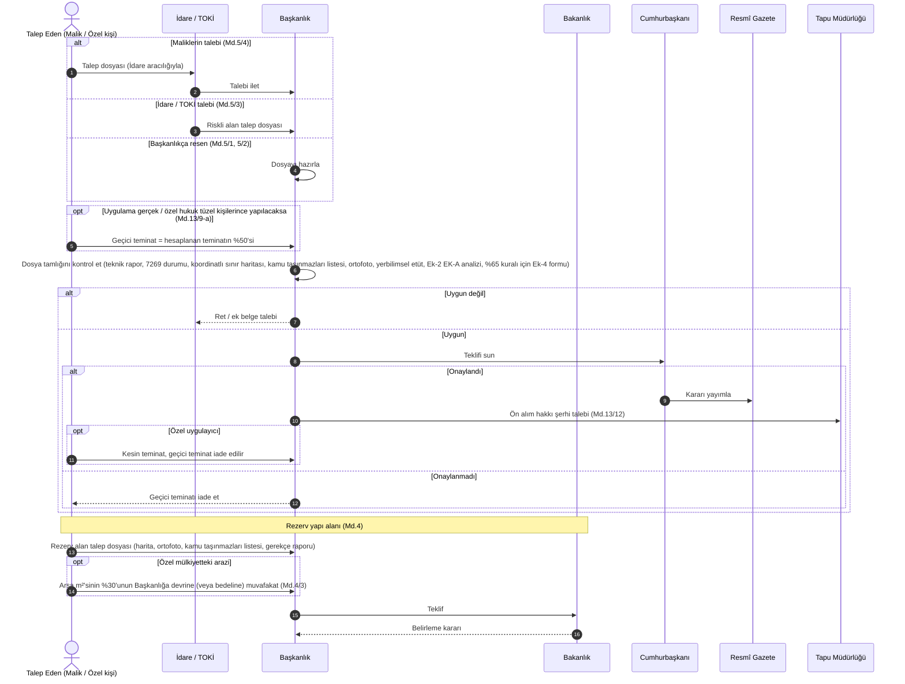
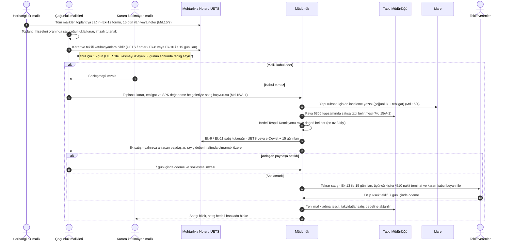
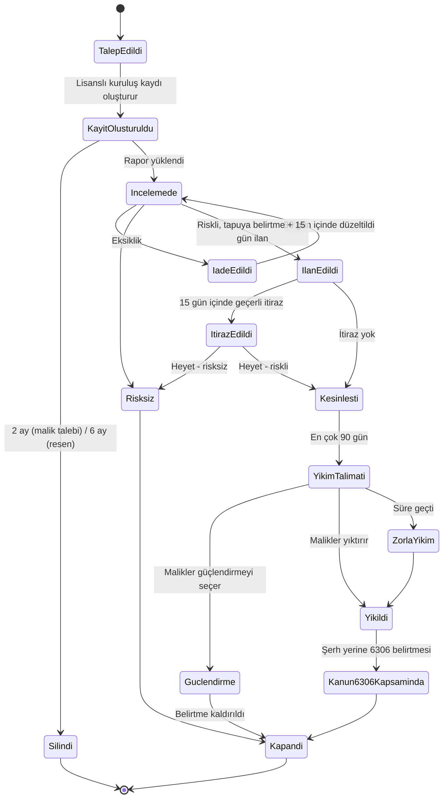

# Kullanıcı Gereksinimleri Dokümanı — Riskli Yapı ve Riskli Alan Yönetimi

| Alan | Değer |
|---|---|
| Doküman No | URS-KD-001-TR |
| Sürüm | 0.1 (Taslak) |
| Tarih | 29.10.2026 |
| Hukuki kaynak | *6306 Sayılı Kanunun Uygulama Yönetmeliği* — RG 15/12/2012, Sayı 28498; RG 4/2/2026, Sayı 33158'e kadar yapılan değişikliklerle birlikte |
| Kaynak adres | https://www.mevzuat.gov.tr/mevzuat?MevzuatNo=16849&MevzuatTur=7&MevzuatTertip=5 |
| Durum | İncelemede |
| İngilizce sürüm | [risky-building-and-zone-user-requirements.md](risky-building-and-zone-user-requirements.md) |

---

## 1. Amaç ve Kapsam

### 1.1 Amaç
Bu doküman, aşağıdaki süreçlerin uçtan uca yürütülmesini destekleyecek yazılım sisteminin (bundan sonra **"Sistem"**) kullanıcı gereksinimlerini tanımlar:

1. **Riskli yapı** tespiti, itiraz, tapu kütüğüne belirtme, tahliye, yıkım veya güçlendirme;
2. **Riskli alan** ve **rezerv yapı alanı** belirlenmesi;
3. Bunlara doğrudan bağlı tespit sonrası süreçler: maliklerin salt çoğunluk kararı, karara katılmayan maliklerin paylarının açık artırma ile satışı, kira yardımı ve masrafların tahsili.

Her gereksinim, Yönetmeliğin ilgili madde ve fıkrasına bağlanmıştır.

### 1.2 Kapsam dışı
- Ek-2'deki mühendislik hesap esasları (*Riskli Yapıların Tespit Edilmesine İlişkin Esaslar*) — Sistem bu hesap yazılımını barındırır / onunla entegre olur, ancak esasları yeniden tanımlamaz.
- Tespit kuruluşları ve mühendislerinin lisanslandırılması, eğitimi, denetimi ve yaptırımlar (Md. 6). Sistem lisans durumunu (etkin / kapalı) Başkanlığın lisans kayıt sisteminden alır ve yalnızca lisansı etkin kuruluşların yapı kaydı oluşturmasına izin verir.
- İmar planlarının hazırlanması ve onayı (Md. 18–19); yalnızca plan bilgileri kaydedilir.
- Kentsel dönüşüm danışmanlık ve müzakere kuruluşları (Md. 15/B) — ayrı bir dokümanda ele alınacaktır.
- Değerleme yöntemi (Md. 12); yalnızca değerleme sonuçları kaydedilir.

---

## 2. Tanımlar ve Kısaltmalar (Md. 3)

| Terim | Anlamı |
|---|---|
| Bakanlık | Çevre, Şehircilik ve İklim Değişikliği Bakanlığı |
| Başkanlık | Kentsel Dönüşüm Başkanlığı |
| Müdürlük | İl Kentsel Dönüşüm Müdürlüğü |
| İdare | Belediye ve mücavir alan sınırları içinde belediye, dışında il özel idaresi, büyükşehirlerde büyükşehir belediyesi (yetkilendirilmesi hâlinde ilçe belediyesi) |
| İlgili kurum | Uygulama alanında dönüşüm projesi yürüten Başkanlık, İdare veya TOKİ |
| Riskli yapı | Riskli alan içinde veya dışında olup ekonomik ömrünü tamamlamış ya da yıkılma veya ağır hasar görme riski taşıdığı ilmî ve teknik verilere dayanılarak tespit edilen yapı |
| Riskli alan | Zemin yapısı veya üzerindeki yapılaşma sebebiyle can ve mal kaybına yol açma riski taşıyan, Cumhurbaşkanınca kararlaştırılan alan |
| Rezerv yapı alanı | Kanun kapsamındaki uygulamalarda kullanılmak üzere Bakanlıkça belirlenen alan |
| Uygulama alanı | Riskli alan, rezerv yapı alanı veya riskli yapının bulunduğu alan |
| Lisanslı kuruluş | Riskli yapı tespiti yapmak üzere Başkanlıkça lisanslandırılan kurum/kuruluş |
| Teknik heyet | İtirazları karara bağlayan yedi üyeli heyet |
| Tapu müdürlüğü | Tapu kütüğünde belirtme/şerh ve tescil işlemlerini yapan birim |
| Muhtarlık | 15 günlük ilanların yapıldığı mahalle muhtarlığı |
| UETS | Ulusal Elektronik Tebligat Sistemi |
| e-Devlet | e-Devlet Kapısı |
| UAVT | Ulusal Adres Veri Tabanı |
| Yapı yaklaşık maliyet bedeli | Bakanlıkça yayımlanan yapı yaklaşık birim maliyeti × yapı inşaat alanı (teminat hesabına esas) |

---

## 3. Aktörler

| No | Aktör | Sistemdeki rolü |
|---|---|---|
| A1 | Malik / kanuni temsilci / mirasçı | Tespit talep eder, itiraz eder, tebligat alır, oy kullanır, kira yardımı başvurusu yapar |
| A2 | Lisanslı kuruluş | Yapı kaydı oluşturur, tespit raporunu hazırlar ve yükler, eksiklikleri giderir |
| A3 | Müdürlük / yetki devredilmiş İdare | Raporları inceler, tapuya bildirir, itirazları alır, teknik heyet sekretaryasını ve satış sürecini yürütür |
| A4 | İdare | Resen tespit yapar, yıkım talimatı verir, yıkım ruhsatı düzenler, zorla yıkım yapar |
| A5 | Başkanlık | Alan teklifleri, internet sayfasında ilan, nihai yetki |
| A6 | Teknik heyet | İtirazları inceler ve nihai kararı verir |
| A7 | Tapu müdürlüğü | Belirtme/şerh ekler ve kaldırır, satışları tescil eder |
| A8 | Muhtarlık | 15 günlük ilanları yapar |
| A9 | e-Devlet / UETS | Elektronik bildirim kanalları |
| A10 | Mülki idare amiri | Zorla giriş/tahliye için yazılı izin ve kolluk desteği sağlar |
| A11 | Elektrik, su ve doğalgaz kuruluşları | Talep üzerine hizmeti keser |
| A12 | Cumhurbaşkanı | Riskli alanı kararlaştırır |
| A13 | TOKİ | Alan/rezerv alan talebinde bulunur; proje yürütür |
| A14 | Kültür varlıklarını koruma bölge kurulu | Tescilli yapılar için tespit sonrası karar verir |
| A15 | Vergi dairesi | Ödenmeyen masrafları 6183 sayılı Kanuna göre tahsil eder |

---

## 4. Sürece Genel Bakış

---

## 5. Sıralı Akış (Sequence) Diyagramları

### 5.1 Ana akış — Riskli yapı tespiti, itiraz ve yıkım (Md. 7, 8, 10, 16)

### 5.2 Riskli alan ve rezerv yapı alanı belirlenmesi (Md. 4, 5, 13/9)

### 5.3 Salt çoğunluk kararı ve karara katılmayanların paylarının açık artırma ile satışı (Md. 15, 15/A)

---

## 6. Fonksiyonel Gereksinimler

Öncelik: **Z** = Zorunlu (yasal yükümlülük), **G** = Gerekli, **İ** = İsteğe bağlı.

### 6.1 Riskli yapı tespit talebi ve tespitin yapılması (Md. 7/1–7/3)

| No | Gereksinim | Önc. | Kaynak |
|---|---|---|---|
| KG-RY-01 | Sistem tespit taleplerini malik veya kanuni temsilcilerinden elektronik olarak alacaktır; arsa paylı tapuda yapının sahibi olan paydaştan, yapı başkasına ait olup tapuda şerh varsa lehine şerh bulunan taraftan kabul edecektir. | Z | 7/2-a |
| KG-RY-02 | Sistem Başkanlığın/İdarenin resen tespit başlatmasına veya maliklerden (ya da İdareden) süre vererek tespit istemesine ve süre dolunca tespiti üstlenmesine imkân verecektir. | Z | 7/2-b |
| KG-RY-03 | Sistem inşaat hâlinde olup ikamet edilmeyen yapılar ile metrukluk vb. sebeple statik bütünlüğü bozulmuş yapılar için talepleri reddedecektir. | Z | 7/1 |
| KG-RY-04 | Sistem UAVT adresi ve bina kodu ile tanımlanan **her yapı için tek rapor** kuralını uygulayacaktır. İstisnalar: itiraz veya yargı kararı üzerine yeniden rapor gerekmesi; raporun gerçeğe aykırı olduğunun tespiti; kasti müdahale dışında risk durumunu etkileyen somut bir hadise. | Z | 7/3 |
| KG-RY-05 | Sistem lisanslı kuruluşun yapı kaydı oluşturmadan önce mevcut rapor kontrolü yapmasını sağlayacaktır. | Z | 7/3 |
| KG-RY-06 | Sistem, tespit **2 ay** içinde yapılmazsa herhangi bir malikin talebiyle kaydın silinmesine imkân verecek, **6 ay** sonunda kaydı resen silecektir. | Z | 7/3 |
| KG-RY-07 | Sistem her raporda UAVT adresi ve bina kodunu zorunlu tutacaktır. | Z | 7/3 |
| KG-RY-08 | Sistem Ek-2 esaslarını uygulayan Başkanlık tespit yazılımını barındıracak veya onunla entegre olacaktır. | Z | 7/1 |
| KG-RY-09 | Sistem tespitin engellenmesi olaylarını kaydedecek, zorla giriş için mülki idare amirinden yazılı izin ve kolluk desteği talebi üretecek ve izin belgesini saklayacaktır. | Z | 7/2-c |
| KG-RY-10 | Sistem resen yapılan tespitlerin masraflarını hesaplayacak, hisse oranında paylaştıracak, tebligat yapacak, 1 aylık ödemeyi izleyecek ve ödenmeyenleri 6183 sayılı Kanuna göre tahsil için (Başkanlıkça yapılmışsa vergi dairesine) yönlendirecektir. | Z | 7/2-b |
| KG-RY-11 | 2863 sayılı Kanun kapsamındaki yapılar için Sistem yalnızca malik talebini kabul edecek, kesinleşmeden sonra koruma bölge kuruluna bildirecek ve kurul kararı kaydedilene kadar işlemleri bekletecektir. | Z | 7/8 |

### 6.2 Rapor incelemesi, tapuya belirtme ve tebligat (Md. 7/4, 7/9)

| No | Gereksinim | Önc. | Kaynak |
|---|---|---|---|
| KG-BLD-01 | Sistem yüklenen raporları yapının bulunduğu ildeki Müdürlüğe (veya yetki devredilmiş İdareye) yönlendirecektir. | Z | 7/4 |
| KG-BLD-02 | Sistem eksik raporların eksiklik listesiyle iadesini destekleyecek; lisanslı kuruluş **30 gün** içinde düzeltecek; gerekçeli ek süre talebi alınabilecektir. | Z | 7/4, 7/9 |
| KG-BLD-03 | Riskli yapılar için Sistem, eksiksiz incelemeden itibaren **en geç 10 iş günü** içinde beyanlar hanesine belirtme için tapu müdürlüğüne elektronik bildirim gönderecek ve süreyi izleyecektir. | Z | 7/4 |
| KG-BLD-04 | Sistem yapıya asılmak üzere **Ek-6 tutanağını** üretecektir. | Z | 7/4 |
| KG-BLD-05 | Sistem tüm maliklere e-Devlet üzerinden bildirim yapacak, muhtarlıkta **15 gün** ilan ve Başkanlık internet sayfasında 15 gün yayın sağlayacaktır. | Z | 7/4 |
| KG-BLD-06 | Sistem **tebliğ edilmiş sayılma tarihini** muhtarlık ilanının son günü olarak hesaplayacak ve itiraz süresinin başlangıcı olarak kullanacaktır. | Z | 7/4, 7/5 |
| KG-BLD-07 | Sistem denetlenebilir bir tebligat kaydı tutacaktır (kanal, tarih, belge, ispat). | Z | 7/4, 8/2 |

### 6.3 İtiraz ve teknik heyet (Md. 7/5–7/7, 9, 10, 11)

| No | Gereksinim | Önc. | Kaynak |
|---|---|---|---|
| KG-ITZ-01 | Sistem, son ilan gününden itibaren **15 gün** içinde malik, kanuni temsilci veya malik vefat etmişse mirasçılarca yapılan itiraz dilekçelerini (çevrim içi veya kayıtlı kâğıt) alacaktır. | Z | 7/5 |
| KG-ITZ-02 | Sistem süresi geçmiş veya yetkisiz kişilerce yapılmış itirazları otomatik olarak "işleme alınmaz" şeklinde işaretleyecektir. | Z | 7/5 |
| KG-ITZ-03 | İlde teknik heyet bulunmuyorsa Sistem dosyayı o il için yetkilendirilmiş heyetin bulunduğu il Müdürlüğüne aktaracaktır. | Z | 7/6 |
| KG-ITZ-04 | Sistem heyet yapısını tutacaktır: rektörlerce **15 gün** içinde bildirilen en az doktor öğretim üyesi 4 üniversite üyesi + Bakanlık/Başkanlıktan 3 üye (2 inşaat, 1 jeoloji/jeofizik mühendisi), yedekleriyle; üyelikler **iki yılda bir ocak ayında** yenilenir. | Z | 9/2–9/5 |
| KG-ITZ-05 | Sistem ilk toplantıda başkan ve başkan yardımcısı seçimini destekleyecektir. | Z | 10/1 |
| KG-ITZ-06 | Sistem **ayda en az bir** toplantı planlayacak, olağanüstü toplantıya imkân verecek ve toplantı bildirimlerini **en az 3 gün** önce gönderecektir. | Z | 10/3 |
| KG-ITZ-07 | Sistem toplantı yeter sayısını (en az 5 üye), salt çoğunlukla kararı ve eşitlikte başkanın oyunu uygulayacaktır. | Z | 10/4 |
| KG-ITZ-08 | Sistem üyelerden menfaat çatışması beyanı (üçüncü dereceye kadar kan ve kayın hısımlığı, her türlü menfaat ilişkisi) alacak ve ilgili üyeyi o gündem maddesinin oylamasından çıkaracaktır. | Z | 10/6 |
| KG-ITZ-09 | Sistem oy hakkı olmayan uzmanların toplantıya davetine imkân verecektir. | G | 10/5 |
| KG-ITZ-10 | Sistem heyetin raporu düzeltme için lisanslı kuruluşa iadesini, yerinde inceleme talebini ve yapının tespit tarihindeki durumuna göre "riskli / risksiz" nihai kararını destekleyecektir. | Z | 10/7 |
| KG-ITZ-11 | Sistem başkan ve üyelerce (e-imza ile) imzalanan gerekçeli kararları kaydedecek; tüm kararları İdareye, yalnızca nihai kararı itiraz eden malike, değişen kararları ayrıca Başkanlığa gönderecektir. | Z | 10/7 |
| KG-ITZ-12 | Sistem heyetçe karara bağlanmış rapora başka bir malikçe yapılan itirazı yeniden incelemeye almayacaktır. | Z | 10/7 |
| KG-ITZ-13 | Tespit itiraz veya yargı kararıyla değişirse Sistem durumu tapu müdürlüğüne bildirecektir. | Z | 7/7 |
| KG-ITZ-14 | Sistem bir yılda 8 veya üst üste 3 toplantıya (izinler hariç) katılmayan üyenin üyeliğini kendiliğinden sona erdirecek ve yeni üye görevlendirilmesini hatırlatacaktır. | Z | 10/8 |
| KG-ITZ-15 | Sistem üniversite üyelerinin huzur hakkını ve 6245 sayılı Kanuna göre yolluk ve gündeliklerini hesaplayacaktır. | G | 11 |
| KG-ITZ-16 | Sistem tespiti etkileyen yargı kararlarının kaydedilmesini destekleyecektir. | Z | 7/3, 7/7 |

### 6.4 Tahliye, yıkım ve güçlendirme (Md. 8, 17)

| No | Gereksinim | Önc. | Kaynak |
|---|---|---|---|
| KG-YIK-01 | Tespitin kesinleşmesiyle (süresinde itiraz yok veya itiraz reddedildi) Sistem Müdürlükten İdareye otomatik yıktırma talebi oluşturacaktır. | Z | 8/1 |
| KG-YIK-02 | Sistem **Ek-7/A** (riskli yapı) veya **Ek-7/B** (riskli alan / rezerv yapı alanı) tutanağını üretecek, yapıya asılmasını, e-Devlet bildirimini, muhtarlıkta ve Başkanlık internet sayfasında 15 gün ilanı sağlayacak; son ilan günü tebliğ sayılacaktır. | Z | 8/2 |
| KG-YIK-03 | Sistem İdarenin **en çok 90 gün** süre ile tahliye/yıkım talimatı vermesine ve sürenin izlenmesine imkân verecektir. | Z | 8/3-a |
| KG-YIK-04 | Sistem herhangi bir malik veya vekilinden yıkım ruhsatı başvurusu alacak ve şunları uygulayacaktır: tahliye ve elektrik, su, doğalgaz aboneliklerinin kapatıldığına dair belge (veya İdare tutanağı); **21.50 m üstü** binalarda statik fenni mesul; diğer maliklerin muvafakati aranmaksızın **6 iş günü** içinde ruhsat düzenlenmesi. | Z | 8/3-b |
| KG-YIK-05 | Sistem altyapı kuruluşlarından elektrik, su ve doğalgaz hizmetinin durdurulmasının istenmesini destekleyecektir. **Not:** Md. 8/3-c'nin yürütmesi durdurulmuştur (Danıştay 4. Daire, 12/2/2026, E.2025/5279); bu işlev riskli yapılar için hukuki durum değişene kadar yapılandırma ile kapatılabilir olmalıdır. | İ | 8/3-c |
| KG-YIK-06 | Sistem yıktırılmayan yapıları kolluk destekli tahliye/yıkım için mülki amire iletecek; Başkanlığın İdareye yazılı bildirimde bulunmasına veya yıkımı bizzat yapmasına imkân verecektir. | Z | 8/3-ç, 8/4 |
| KG-YIK-07 | Sistem engelleme tutanaklarını kaydedecek; engelleyenler hakkında suç duyurusu ve görevini yapmayan kamu görevlileri hakkında disiplin kaydını destekleyecektir. | Z | 8/6 |
| KG-YIK-08 | Sistem yıkım süresi içinde güçlendirme yolunu destekleyecektir: teknik olarak mümkün olduğunun tespiti, KMK 19/2 kararı, güçlendirme projesi, ruhsat; tamamlandıktan sonra belirtmenin kaldırılması başvurusu. | Z | 8/7 |
| KG-YIK-09 | Sistem yıktırılan yapıları kaydedecek; İdare, yıkılamayan yapıları **ikişer aylık** periyotlarla Müdürlüğe bildirecektir. | Z | 8/8 |
| KG-YIK-10 | Sistem tahliye/yıkım masraflarını hisse oranında paylaştıracak, maliklere tebliğ edecek, 1 aylık ödemeyi izleyecek ve 6183 sayılı Kanuna göre tahsile yönlendirecektir. | Z | 8/8 |
| KG-YIK-11 | Yıkımdan sonra Sistem riskli yapı şerhinin terkinini ve arsanın tapusuna "6306 sayılı Kanun kapsamındadır" belirtmesi yapılmasını talep edecektir. | Z | 8/9 |
| KG-YIK-12 | Riskli alan/rezerv alanlarda Sistem tahliye takvimini yönetecektir: kurumca yürütülende 15 gün, maliklerce yürütülende anlaşmadaki süre (süre yoksa en az 30 gün); noter veya 15 gün ilanla bildirim, zorla tahliye ihtarı ve borçlar/vergiler ödendikten sonra boş yapının teslim kaydı. | Z | 17/1 |
| KG-YIK-13 | Sistem alanlarda, etap/adada tahliye edilen tüm yapılar için salt çoğunluk anlaşmasına dayalı yıkım ruhsatı düzenlenmesini destekleyecektir. | Z | 17/2 |
| KG-YIK-14 | Bir parselde birden fazla yapı bulunup yalnızca bir kısmı riskli ise Sistem sadece riskli yapılara açık adresiyle belirtme işletecek ve oylamayı bu yapıların maliklerine sınırlayacaktır. | Z | 15/7 |

### 6.5 Riskli alan belirlenmesi (Md. 5)

| No | Gereksinim | Önc. | Kaynak |
|---|---|---|---|
| KG-RA-01 | Sistem riskli alan talep dosyalarını Başkanlıktan (resen), İdareden, TOKİ'den ve taşınmaz maliklerinden (Başkanlığa veya İdareye; İdare Başkanlığa iletir) alacaktır. | Z | 5/1, 5/3, 5/4 |
| KG-RA-02 | Sistem dosya kontrol listesini uygulayacaktır: risk teknik raporu; 7269 sayılı Kanuna göre afete maruz bölge bilgisi; alan büyüklüğünü içeren koordinatlı sınırlandırma haritası ve varsa uygulama imar planı; kamu taşınmazları listesi; uydu/ortofoto; zemin kaynaklıysa yerbilimsel etüt raporu; Ek-2 EK-A analiz ve raporu; Başkanlıkça istenecek diğer belgeler. | Z | 5/1 |
| KG-RA-03 | Sistem alternatif ölçütleri destekleyecektir: kamu düzeninin bozulduğu yerlerde planlama/altyapı yetersizliği, imara aykırı yapılaşma veya hasar; ya da yapıların **en az %65'inin** imara aykırı/ruhsatsız olması — bu durumda **Ek-4 Yapı Değerlendirme Formu** zorunlu ve oran otomatik hesaplanır. | Z | 5/2 |
| KG-RA-04 | Sistem teklif akışını yönetecektir: Başkanlık değerlendirmesi → Cumhurbaşkanına sunulması → Resmî Gazete yayım bilgisi. | Z | 5/1 |
| KG-RA-05 | Uygulama özel kişilerce yapılacaksa Sistem teminatı hesaplayacaktır (yapı yaklaşık maliyetinin 50.000 m²'ye kadar %10, 50–75 bin %8, 75–100 bin %6, 100 bin üstü %4); %50'sini teklifle geçici teminat olarak alacak, onaylanmazsa iade edecek, onaylanırsa kesin teminatı alacak ve planlama sonrası farkı düzeltecektir. | Z | 13/9-a |
| KG-RA-06 | Sistem riskli alan ve rezerv alanlardaki parsellere ön alım hakkı şerhi talep edecek ve tapudan satış bildirimlerini alacaktır. | Z | 13/12 |
| KG-RA-07 | Sistem alanları sınırları ve parsel durumlarıyla CBS haritasında gösterecektir. | G | 5/1-c |

### 6.6 Rezerv yapı alanı belirlenmesi (Md. 4)

| No | Gereksinim | Önc. | Kaynak |
|---|---|---|---|
| KG-RZ-01 | Sistem TOKİ, İdare ve gerçek/özel hukuk tüzel kişilerinden rezerv alan taleplerini ve Başkanlığın resen tekliflerini alacaktır; belirleme Başkanlığın teklifi üzerine Bakanlıkça yapılır. | Z | 4/1–4/3 |
| KG-RZ-02 | Sistem kontrol listesini uygulayacaktır: alan büyüklüğünü içeren koordinatlı hâlihazır harita; uydu/ortofoto; kamu taşınmazları listesi; yeni yerleşim alanları için gözlemsel gerekçe raporu; diğer belgeler. | Z | 4/1 |
| KG-RZ-03 | Özel mülkiyetteki arazilerde (Bakanlığa bağlı kuruluşlar hariç) Sistem yapılaşmaya esas arsa m²'sinin **%30'unun** Başkanlığa devrine muvafakati veya bedelinin özel hesaba yatırılmasını kaydedecektir. | Z | 4/3 |
| KG-RZ-04 | Sistem özel uygulayıcılar için yapı ruhsatından önce teminatı (KG-RA-05 ile aynı kademeler) hesaplayacak; ruhsatlar aynı tarihte düzenlenirse toplam alan üzerinden hesaplayacaktır. | Z | 13/9-b |

### 6.7 Malik kararları ve açık artırma (Md. 15, 15/A)

| No | Gereksinim | Önc. | Kaynak |
|---|---|---|---|
| KG-KRR-01 | Sistem herhangi bir malikin **Ek-12** formuyla tüm malikleri toplantıya çağırmasına; muhtarlıkta / bina kapısında 15 gün ilan veya noter yoluyla bildirime imkân verecektir. | Z | 15/2 |
| KG-KRR-02 | Sistem toplantı ve karar yeter sayısını kişi sayısına göre değil, **hisseleri oranında salt çoğunluk** ile hesaplayacak ve imzalı tutanağı kaydedecektir. | Z | 15/2, 15/6–15/8 |
| KG-KRR-03 | Sistem karar ve teklifi katılmayanlara bildirecek (UETS adresi varsa UETS, yoksa noter veya Ek-8 / Ek-10 ile 15 gün ilan) ve tebliğ tarihini hesaplayacaktır (UETS'de ulaşmayı izleyen 5. gün sonu; ilanda son gün). | Z | 15/2 |
| KG-KRR-04 | Sistem katılmayanlar için **15 günlük** kabul süresini izleyecektir. | Z | 15/2 |
| KG-KRR-05 | Sistem gerekli belgelerle satış başvurusunu alacak ve yapı ruhsatından önce ruhsat veren İdareye ön inceleme yazısı gönderilmesini zorunlu kılacaktır. | Z | 15/4, 15/A-1 |
| KG-KRR-06 | Sistem paya "6306 sayılı Kanuna göre satışa tabidir — devredilemez" belirtmesi yapılmasını tapudan talep edecektir. | Z | 15/A-2 |
| KG-KRR-07 | Sistem Bedel Tespiti Komisyonu ve Satış Komisyonunu (her biri en az 3 kişi) yönetecek, SPK lisanslı değerlemeleri gözeterek rayiç değeri kaydedecektir. | Z | 15/A-3 |
| KG-KRR-08 | Sistem Ek-9 / Ek-11 satış tutanaklarını ve tekrar satışlar için Ek-13 ilan formunu üretecektir. | Z | 15/A-4, 15/A-12 |
| KG-KRR-09 | Sistem açık artırmayı yürütecektir: ilk satışa yalnızca anlaşan paydaşlar; sonraki satışlara yazılı kabul beyanı ve **%10 nakit teminat** ile üçüncü kişiler; rayiç değerin altında teklif kabul edilmez; artırma tutanağı; tek katılımcı kuralı. | Z | 15/A-6–15/A-9, 15/A-13 |
| KG-KRR-10 | Sistem **7 günlük** ödeme ve sözleşme imzalama süresini uygulayacak, sırasıyla diğer teklif sahiplerine geçecek, üçüncü kişinin temerrüdünde teminatını Başkanlığa gelir kaydedecektir. | Z | 15/A-8, 15/A-14, 15/A-15 |
| KG-KRR-11 | Sistem satışı tapuda tescil ettirecek, takyidatları bloke edilen satış bedeline aktaracak ve eski malike bildirecektir. | Z | 15/A-5, 15/A-10 |
| KG-KRR-12 | Riskli alan/rezerv alanlarda hiçbir paydaş satın almazsa Sistem payın rayiç bedelle uygulamayı yürüten kurum (Başkanlık/İdare/TOKİ) tarafından satın alınmasına yönlendirecektir. | Z | 15/3 |
| KG-KRR-13 | Sistem bedelin eksik hesaplanması gerekçesiyle verilen iptal kararlarını kaydedecek ve ihale tarihinden itibaren yasal faiziyle fark bedeli hesaplayacaktır. | G | 15/A-16 |
| KG-KRR-14 | Sistem müteahhitle yapılan sözleşmelerin feshi taleplerini (1 yıl işe başlamama / 6 ay durma), müteahhide 15 gün süre, 30 günlük ihtar ve resen feshi destekleyecektir. | G | 13/11 |

### 6.8 Kira yardımı ve mali destekler (Md. 16)

| No | Gereksinim | Önc. | Kaynak |
|---|---|---|---|
| KG-YRD-01 | Sistem kira yardımı başvurularını tahliye veya yıkımdan itibaren **1 yıl** içinde alacaktır (riskli yapılarda Müdürlüğe, alanlarda ilgili kuruma). | Z | 16/4 |
| KG-YRD-02 | Sistem süreleri uygulayacaktır: alan dışındaki riskli yapılarda **18 ay**; riskli ve rezerv alanlarda ilgili kurumca belirlenen **en çok 48 ay**. | Z | 16/1 |
| KG-YRD-03 | Sistem defaten ödemeleri destekleyecektir: kiracı / işyeri işleten / anlaşmayla kamulaştırılan = aylık kiranın 2 katı; kapıcı dairesinde oturan kapıcı ve sınırlı ayni hak sahibi = 5 katı; 6/A uygulamalarında taşınma yardımı = 3 katı. | Z | 16/3, 16/5 |
| KG-YRD-04 | Sistem 2016/8663 sayılı Karar kapsamında malik, kiracı veya sınırlı ayni hak sahibi olmaksızın kullananlara (gecekondu sahiplerine riskli yapılarda aylık kiranın 2 katı dâhil) yardımı destekleyecektir. | G | 16/2 |
| KG-YRD-05 | Sistem aynı kişiye Dönüşüm Projeleri Özel Hesabından hem kira yardımı hem faiz desteği verilmesini engelleyecektir. | Z | 16/7 |
| KG-YRD-06 | Sistem faiz desteği uygunluğunu kaydedecektir: tahliye/yıkımdan itibaren **3 yıl** içinde Başkanlıkla protokollü bankaya başvuru. | Z | 16/6 |
| KG-YRD-07 | Sistem Başkanlığın uygun görmesi hâlinde kira yardımının 1 yıla kadar olan kısmının peşin ödenmesine imkân verecektir. | İ | 16/5 |
| KG-YRD-08 | Sistem harç ve ücret muafiyetlerini işaretleyecektir (mevcut inşaat alanının 1,5 katına kadar belediye harç ve ücreti alınmaz; tevhitte oransal muafiyet). | G | 16/10–16/12 |

### 6.9 Yıkım sonrası parsel işlemleri (Md. 15/8–15/10)

| No | Gereksinim | Önc. | Kaynak |
|---|---|---|---|
| KG-PRS-01 | Sistem, üzerindeki yapıların tamamı riskli olan parsellerin her parselde ayrı salt çoğunlukla tevhidini; boş parsellerle tevhitte boş parsel maliklerinin oybirliğini destekleyecektir. | Z | 15/8 |
| KG-PRS-02 | Riskli parselin ifrazında Sistem 6306 kapsamını yalnızca riskli yapının bulunduğu parsel(ler)de tutacak, diğer parsellerden şerhi kaldıracaktır. | Z | 15/8 |
| KG-PRS-03 | Sistem imar hakkının başka parsele aktarımını ve Müdürlük yazısının belediyelere ve tapu müdürlüklerine bildirilmesini destekleyecektir. | G | 15/10 |

---

## 7. İş Kuralları ve Süreler (özet)

| Kural | Değer | Madde |
|---|---|---|
| Yapı kaydından sonra tespit süresi | 2 ay (malik talebiyle silme) / 6 ay (resen silme) | 7/3 |
| Eksik raporun düzeltilmesi | 30 gün (+ gerekçeli talep üzerine ek süre) | 7/9 |
| Riskli yapının tapuya bildirilmesi | En geç 10 iş günü | 7/4 |
| İlan (muhtarlık, internet sayfası) | 15 gün; son gün tebliğ sayılır | 7/4, 8/2 |
| İtiraz süresi | Son ilan gününden itibaren 15 gün | 7/5 |
| Heyet üyelerinin rektörlerce bildirilmesi | 15 gün | 9/3 |
| Heyet üyeliklerinin yenilenmesi | İki yılda bir, ocak ayı | 9/5 |
| Heyet toplantısı | Ayda en az 1; en az 3 gün önceden bildirim | 10/3 |
| Heyet toplantı / karar yeter sayısı | 7 üyeden en az 5 / salt çoğunluk, eşitlikte başkan | 10/4 |
| Tahliye ve yıkım süresi | En çok 90 gün | 8/3-a |
| Yıkım ruhsatı düzenlenmesi | 6 iş günü | 8/3-b |
| Yıkımda statik fenni mesul | 21.50 m'den yüksek binalar | 8/3-b |
| Masraf ödemesi (tespit / yıkım) | Tebligattan sonra 1 ay, sonra 6183 sayılı Kanun | 7/2-b, 8/8 |
| Yıkılamayan yapıların bildirimi | İkişer aylık periyotlar | 8/8 |
| Toplantı ilanı / katılmayanların kabul süresi | 15 gün / 15 gün | 15/2 |
| UETS'de tebliğ sayılma | Ulaşmayı izleyen 5. günün sonu | 13/14, 15/2, 15/A-4 |
| İhale üzerinde kalanın ödeme ve sözleşmesi | 7 gün | 15/A-8 |
| Üçüncü kişi nakit teminatı | Rayiç değerin %10'u | 15/A-13 |
| Alanlarda tahliye | 15 gün (kurum takvimi) / anlaşmadaki süre, süre yoksa en az 30 gün | 17/1 |
| Kira yardımı başvurusu | Tahliye/yıkımdan itibaren 1 yıl | 16/4 |
| Kira yardımı süresi | 18 ay (riskli yapı) / en çok 48 ay (alanlar) | 16/1 |
| Faiz desteği için banka başvurusu | 3 yıl | 16/6 |
| Riskli alan "%65 kuralı" | Yapıların en az %65'i imara aykırı | 5/2-b |
| Özel rezerv alan katkısı | Arsa m²'sinin %30'u | 4/3 |
| Teminat kademeleri (alanlar) | m² aralığına göre %10 / %8 / %6 / %4 | 13/9 |
| Teminat (riskli yapı parselleri) | Yapı yaklaşık maliyetinin %6'sı (muaf: bodrum hariç en çok 2 kat, ≤500 m², malikin kendi yapısı) | 13/9-c |

---

## 8. Dosya Durum Modeli

---

## 9. Fonksiyonel Olmayan Gereksinimler

| No | Gereksinim |
|---|---|
| FOG-01 | **Entegrasyon:** e-Devlet (bildirim, vatandaş girişi), UETS (elektronik tebligat), TAKBİS / tapu (belirtme, satış tescili), UAVT (adres, bina kodu), Yapı Denetim Sistemi (inşaat ilerlemesi), Başkanlık lisans kayıt sistemi (tespit kuruluşlarının lisans durumu), altyapı kuruluşları, Resmî Gazete bilgisi. |
| FOG-02 | **Elektronik imza:** Tüm raporlar, heyet kararları ve tutanaklar nitelikli elektronik imza ile imzalanacaktır. |
| FOG-03 | **Süre motoru:** Resmî tatilleri dikkate alarak takvim günü ve iş günü hesabı; kanala göre tebliğ sayılma kuralları. |
| FOG-04 | **İz kaydı:** Her durum değişikliği, tebligat, belge ve kullanıcı işleminin değiştirilemez kaydı; arşiv mevzuatına uygun saklama. |
| FOG-05 | **Kişisel verilerin korunması:** Malik kimliği, hisse ve mali veriler için 6698 sayılı KVKK'ya uyum; il/kurum bazında rol tabanlı erişim. |
| FOG-06 | **Yetki devri:** Müdürlük yetkilerinin il bazında İdareye devrinin yapılandırılabilmesi. |
| FOG-07 | **Mevzuat esnekliği:** Yönetmelik sık değiştiğinden süreler, oranlar, formlar (Ek-1…13) ve yürütmesi durdurulan hükümler (ör. Md. 8/3-c) kod değişikliği gerektirmeden yapılandırılabilmelidir. |
| FOG-08 | **Belge şablonları:** Ek-1, 4, 5, 6, 7/A, 7/B, 8, 9, 10, 11, 12, 13 yazdırılabilir PDF olarak üretilecektir. |
| FOG-09 | **Erişilebilirlik ve raporlama:** Başkanlık için gösterge paneli (duruma göre dosyalar, süre aşımları, itirazlar, il bazında yıkımlar). |
| FOG-10 | **Dil:** Türkçe arayüz; hukuki terimler Yönetmelik metniyle uyumlu. |

---

## 10. Açık Konular ve Hukuki Notlar

| No | Konu |
|---|---|
| AK-1 | **Md. 8/3-c** (yıktırılmayan riskli yapılara hizmet kesilmesi) hükmünün **yürütmesi durdurulmuştur** — Danıştay 4. Daire, 12/2/2026, E.2025/5279. Md. 17/1'de alanlar için benzer bir hizmet kesme hükmü bulunmaktadır; etkilenip etkilenmediği hukuk birimince teyit edilmelidir. |
| AK-2 | **Md. 15/B**'deki danışmanlık kuruluşlarının uyuşmazlık çözümü yetkisi iptal edilmiştir — Danıştay 8. Daire, 2/6/2026, E.2024/5003 K.2026/3501. Bu doküman kapsamı dışındadır, ancak geliştirilmemelidir. |
| AK-3 | Md. 17/1'de zorla tahliye ihtarı için *"otuz günden az olmak üzere"* ifadesi geçmektedir; muhtemelen "az olmamak üzere" kastedilmiştir. Yapılandırmadan önce hukuki yorum gereklidir. |
| AK-4 | Ek-2 hesap esasları ve Ek formlar ayrıca yayımlanmaktadır ("Ekleri"); güncel sürümleri temin edilip eklenmelidir. |
| AK-5 | Tespite karşı açılan idari davalarla ilişki yalnızca kısmen düzenlenmiştir (Md. 7/3, 7/7); yürütmeyi durdurma kararlarının işlenme süreci tanımlanmalıdır. |

---

## 11. İzlenebilirlik Matrisi

| Madde | Gereksinimler |
|---|---|
| Md. 3 | §2 Tanımlar |
| Md. 4 | KG-RZ-01 … 03 |
| Md. 5 | KG-RA-01 … 04, 07 |
| Md. 7 | KG-RY-01 … 11, KG-BLD-01 … 07, KG-ITZ-01 … 03, 13, 16 |
| Md. 8 | KG-YIK-01 … 11 |
| Md. 9 | KG-ITZ-04 |
| Md. 10 | KG-ITZ-05 … 12, 14 |
| Md. 11 | KG-ITZ-15 |
| Md. 13 | KG-RA-05, 06, KG-RZ-04, KG-KRR-14 |
| Md. 15 | KG-KRR-01 … 05, 12, KG-YIK-14, KG-PRS-01 … 03 |
| Md. 15/A | KG-KRR-06 … 11, 13 |
| Md. 16 | KG-YRD-01 … 08 |
| Md. 17 | KG-YIK-12, 13 |

### İngilizce sürümle kimlik eşleştirmesi

| Türkçe | İngilizce |
|---|---|
| KG-RY | UR-RB |
| KG-BLD | UR-NOT |
| KG-ITZ | UR-OBJ |
| KG-YIK | UR-DEM |
| KG-RA (Riskli alan) | UR-RZ |
| KG-RZ (Rezerv yapı alanı) | UR-RA |
| KG-KRR | UR-DEC |
| KG-YRD | UR-AID |
| KG-PRS | UR-PRC |
| FOG | NFR |
| AK | OI |
