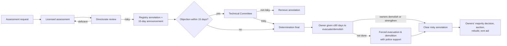
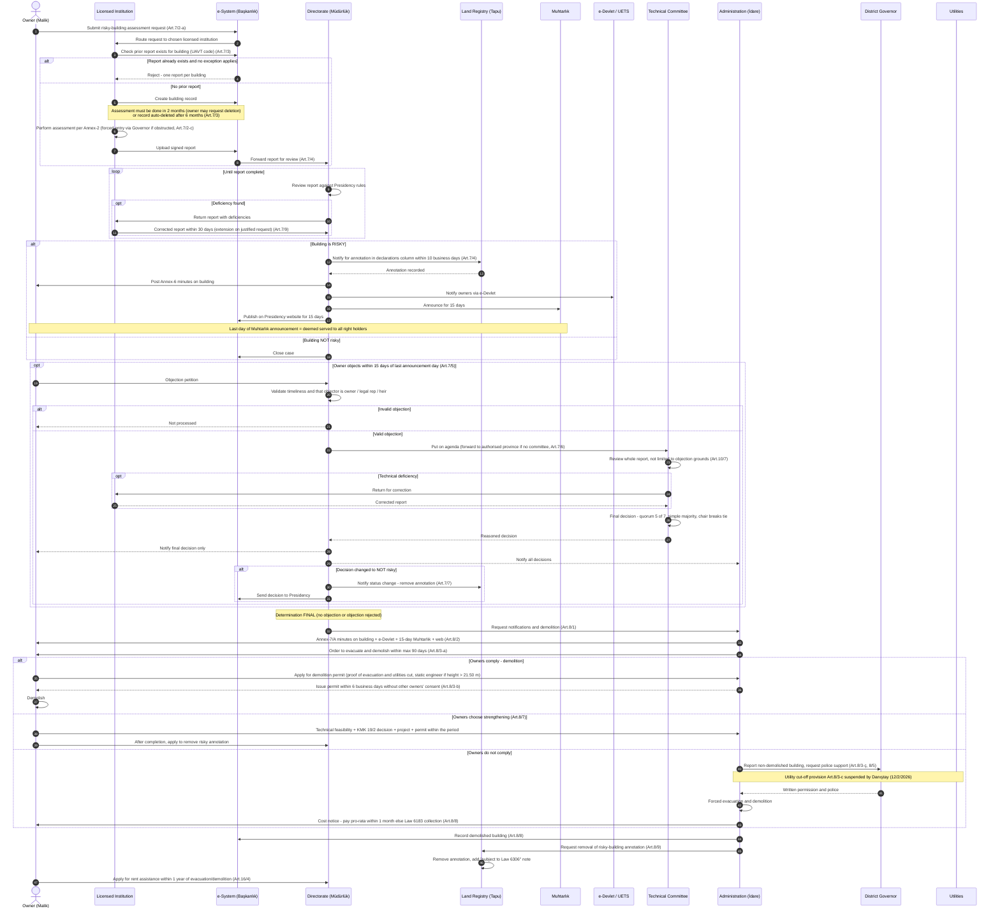
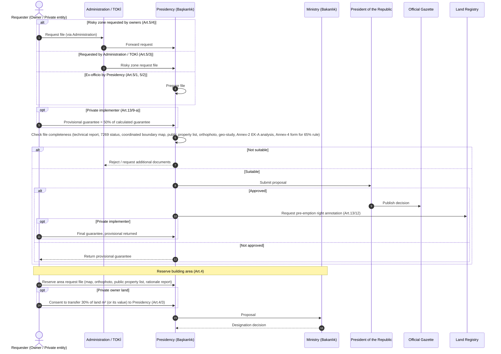
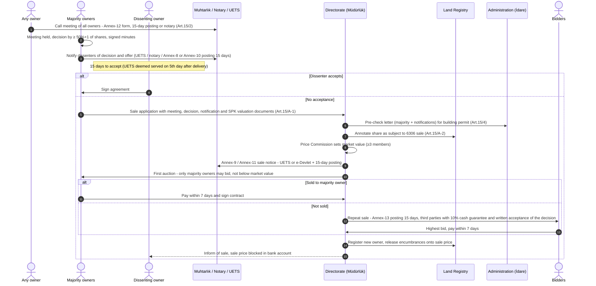
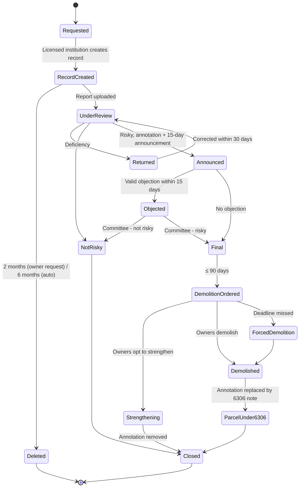

# User Requirements Specification — Risky Building & Risky Zone Management

| Field | Value |
|---|---|
| Document ID | URS-KD-001 |
| Version | 0.1 (Draft) |
| Date | 2026-10-29 |
| Legal source | *6306 Sayılı Kanunun Uygulama Yönetmeliği* (Implementing Regulation of Law No. 6306 on the Transformation of Areas Under Disaster Risk) — RG 15/12/2012, No. 28498, consolidated up to RG 4/2/2026, No. 33158 |
| Source URL | https://www.mevzuat.gov.tr/mevzuat?MevzuatNo=16849&MevzuatTur=7&MevzuatTertip=5 |
| Status | For review |
| Turkish version | [riskli-yapi-ve-alan-kullanici-gereksinimleri.md](riskli-yapi-ve-alan-kullanici-gereksinimleri.md) |

---

## 1. Purpose and Scope

### 1.1 Purpose
This document defines the user requirements for a software system (hereafter **"the System"**) that supports the end-to-end lifecycle of:

1. **Risky building** (*riskli yapı*) determination, objection, land-registry annotation, evacuation, demolition or strengthening;
2. **Risky zone** (*riskli alan*) and **reserve building area** (*rezerv yapı alanı*) determination;
3. Post-determination processes directly tied to them: owner majority decisions, sale of dissenting owners' shares by auction, rent assistance and cost recovery.

Each requirement is traced to the article (*madde*) and paragraph (*fıkra*) of the Regulation.

### 1.2 Out of scope
- Detailed engineering calculation rules of Annex-2 (*Riskli Yapıların Tespit Edilmesine İlişkin Esaslar*) — the System integrates with / hosts the calculation software but does not redefine it.
- Zoning plan preparation and approval (Art. 18–19), except storing plan references.
- Urban transformation consulting firms (Art. 15/B) — separate specification.
- Valuation methodology (Art. 12), except recording valuation results.

---

## 2. Definitions and Abbreviations (Art. 3)

| Term | Turkish | Meaning |
|---|---|---|
| Ministry | Bakanlık | Ministry of Environment, Urbanisation and Climate Change |
| Presidency | Başkanlık | Urban Transformation Presidency (*Kentsel Dönüşüm Başkanlığı*) |
| Directorate | Müdürlük | Provincial Urban Transformation Directorate |
| Administration | İdare | Municipality / metropolitan municipality / special provincial administration (or district municipality if authorised) |
| Relevant institution | İlgili kurum | Presidency, Administration or TOKİ carrying out a transformation project |
| Risky building | Riskli yapı | A building inside or outside a risky zone that has completed its economic life or is at risk of collapse/heavy damage, determined on scientific and technical data |
| Risky zone | Riskli alan | An area carrying risk of loss of life/property due to ground conditions or construction on it, decided by the President of the Republic |
| Reserve building area | Rezerv yapı alanı | Area designated by the Ministry for use as a new settlement area in the scope of the Law |
| Application area | Uygulama alanı | Risky zone, reserve area, or the parcel(s) hosting risky building(s) |
| Licensed institution | Lisanslı kurum/kuruluş | Organisation licensed by the Presidency to perform risky-building assessments |
| Technical Committee | Teknik heyet | 7-member committee that decides on objections |
| Land registry | Tapu müdürlüğü | Title deed office |
| Mukhtar's office | Muhtarlık | Neighbourhood headman's office (public notice board) |
| UETS | Ulusal Elektronik Tebligat Sistemi | National e-Notification System |
| e-Devlet | e-Devlet Kapısı | Government e-services gateway |
| UAVT | Ulusal Adres Veri Tabanı | National Address Database |
| Approximate building cost | Yapı yaklaşık maliyet bedeli | Ministry unit cost × construction area (used for guarantees) |

---

## 3. Actors

| ID | Actor | Role in the System |
|---|---|---|
| A1 | Property Owner (*Malik*) / legal representative / heir | Requests assessment, objects, receives notices, votes, applies for rent aid |
| A2 | Licensed Institution | Creates building record, performs and uploads assessment report, fixes deficiencies |
| A3 | Directorate (*Müdürlük*) / authorised Administration | Reviews reports, notifies registry, receives objections, runs committee secretariat, sale process |
| A4 | Administration (*İdare*) | Ex-officio assessment, demolition orders, demolition permit, forced demolition |
| A5 | Presidency (*Başkanlık*) | Licensing, auditing, zone proposals, web publication, final authority |
| A6 | Technical Committee | Reviews objections and issues final decision |
| A7 | Land Registry (*Tapu*) | Adds/removes annotations (*şerh/belirtme*), registers sales |
| A8 | Mukhtar's Office | Posts 15-day public announcements |
| A9 | e-Devlet / UETS | Electronic notification channels |
| A10 | District Governor / Governor (*Mülki amir*) | Grants written permission and police support for forced entry/evacuation |
| A11 | Utility Providers | Cut electricity, water, natural gas on request |
| A12 | President of the Republic (*Cumhurbaşkanı*) | Decides risky zones |
| A13 | TOKİ | Requests zone/reserve designation; runs projects |
| A14 | Cultural Heritage Board | Decides on listed buildings after assessment |
| A15 | Tax Office | Collects unpaid costs under Law 6183 |

---

## 4. Process Overview

---

## 5. Sequence Diagrams

### 5.1 Main workflow — Risky building determination, objection and demolition (Art. 7, 8, 10, 16)

### 5.2 Risky zone and reserve area determination (Art. 4, 5, 13/9)

### 5.3 Owner majority decision and auction of dissenting shares (Art. 15, 15/A)

---

## 6. Functional Requirements

Priority: **M** = Must (legal obligation), **S** = Should, **C** = Could.

### 6.1 Licensing of assessment institutions (Art. 6)

| ID | Requirement | Pri | Source |
|---|---|---|---|
| UR-LIC-01 | The System shall allow eligible organisation types (public bodies, universities, companies with ≥40% public capital, earthquake NGOs, 4708 building inspection & lab firms, TMMOB-registered offices) to apply for a licence online with document upload. | M | 6/1, 6/4 |
| UR-LIC-02 | The System shall collect: petition, registration/permit certificate, trade registry status & gazette, UETS address and manager e-signature declaration, engineer eligibility documents and e-signature declarations, Annex-3 undertaking, fee receipt. | M | 6/4 |
| UR-LIC-03 | The System shall validate engineer eligibility: active chamber membership, ≥5 years' practice, training completion, exam score ≥70/100 (waived for university faculty; for 4708 inspectors only training + e-signature). | M | 6/2, 6/4 |
| UR-LIC-04 | The System shall enforce at least one civil engineer per licensed institution and prevent an engineer from being assigned to / partner in more than one licensed institution simultaneously. | M | 6/3 |
| UR-LIC-05 | The System shall generate a Licence Certificate per Annex-1 on approval. | M | 6/4 |
| UR-LIC-06 | The System shall require change notifications (partners, name, address, engineers) within 30 days and flag overdue notifications. | M | 6/6 |
| UR-LIC-07 | The System shall automatically block new building records/actions when: no civil engineer assigned; change not notified on time; 4708 work ban active; chamber suspension active; engineers lack training within 6 months of a rule change; no active UETS address. Block lifts when the condition clears. | M | 6/8, 6/13 |
| UR-LIC-08 | The System shall record administrative sanctions and fines, track 1-month payment, and produce a referral to the tax office when unpaid. | M | 6/9, 6/10 |
| UR-LIC-09 | The System shall support filing criminal complaints (record + export) for false documents or reports on non-existent buildings. | S | 6/12 |
| UR-LIC-10 | The System shall send all notifications to licensed institutions via their UETS address. | M | 6/14 |

### 6.2 Risky building assessment request and execution (Art. 7/1–7/3)

| ID | Requirement | Pri | Source |
|---|---|---|---|
| UR-RB-01 | The System shall accept assessment requests electronically from owners or legal representatives; for undivided land shares, from the share-holder owning the building; where the building belongs to another as annotated, from the annotation beneficiary. | M | 7/2-a |
| UR-RB-02 | The System shall allow the Presidency/Administration to start an ex-officio assessment or to order owners (or the Administration) to commission one within a set period, and to take over when the period lapses. | M | 7/2-b |
| UR-RB-03 | The System shall reject requests for buildings under construction and not inhabited, or buildings whose structural integrity is already broken (derelict). | M | 7/1 |
| UR-RB-04 | The System shall enforce **one report per building**, identified by UAVT address and building code, except when: re-assessment is required by objection or court ruling; the report was found false; or a concrete event (other than intentional intervention) changed the risk status. | M | 7/3 |
| UR-RB-05 | The System shall let a licensed institution check for existing reports before creating a building record. | M | 7/3 |
| UR-RB-06 | The System shall allow any owner to request deletion of a building record if no assessment is completed within **2 months**, and shall auto-delete the record after **6 months**. | M | 7/3 |
| UR-RB-07 | The System shall require UAVT address and building code in every report. | M | 7/3 |
| UR-RB-08 | The System shall host / integrate the Presidency's assessment software implementing Annex-2 rules. | M | 7/1 |
| UR-RB-09 | The System shall record obstruction incidents and generate a request to the District Governor for written permission and police support for forced entry; it shall store the permission document. | M | 7/2-c |
| UR-RB-10 | The System shall calculate assessment costs for ex-officio assessments, apportion them by ownership share, issue notices, track 1-month payment, and refer unpaid amounts to the tax office (Presidency) or Administration collection (Law 6183). | M | 7/2-b |
| UR-RB-11 | For buildings protected under Law 2863, the System shall only accept owner-initiated requests and, after finalisation, notify the Regional Cultural Heritage Board and hold further action until its decision is recorded. | M | 7/8 |

### 6.3 Report review, registry annotation and notification (Art. 7/4, 7/9)

| ID | Requirement | Pri | Source |
|---|---|---|---|
| UR-NOT-01 | The System shall route uploaded reports to the Directorate of the building's province (or the authorised Administration). | M | 7/4 |
| UR-NOT-02 | The System shall support return of deficient reports with a deficiency list; the licensed institution must correct within **30 days**; the System shall support a justified extension request. | M | 7/4, 7/9 |
| UR-NOT-03 | For risky buildings, the System shall send an electronic notification to the Land Registry for annotation in the *beyanlar* column **within 10 business days** of a complete review, and track the SLA. | M | 7/4 |
| UR-NOT-04 | The System shall generate the **Annex-6 minutes** for posting on the building. | M | 7/4 |
| UR-NOT-05 | The System shall notify all owners via e-Devlet, publish a **15-day** announcement at the Muhtarlık, and publish on the Presidency website for 15 days. | M | 7/4 |
| UR-NOT-06 | The System shall compute the **deemed-service date** as the last day of the Muhtarlık announcement and use it as the start of the objection period. | M | 7/4, 7/5 |
| UR-NOT-07 | The System shall maintain an auditable notification log (channel, date, document, proof). | M | 7/4, 8/2 |

### 6.4 Objection and Technical Committee (Art. 7/5–7/7, 9, 10, 11)

| ID | Requirement | Pri | Source |
|---|---|---|---|
| UR-OBJ-01 | The System shall accept objection petitions (online or registered paper) by owners, legal representatives or—if the owner is deceased—heirs, within **15 days** from the last announcement day. | M | 7/5 |
| UR-OBJ-02 | The System shall automatically flag objections that are late or from ineligible persons as "not processed". | M | 7/5 |
| UR-OBJ-03 | Where no committee exists in the province, the System shall transfer the file to the Directorate of the province with an authorised committee. | M | 7/6 |
| UR-OBJ-04 | The System shall maintain committee composition: 4 university members (min. Dr. faculty, nominated by rectors within **15 days**) + 3 Ministry/Presidency members (2 civil engineers, 1 geology/geophysics engineer), with alternates; renewal every **2 years in January**. | M | 9/2–9/5 |
| UR-OBJ-05 | The System shall support election of chair and vice-chair at the first meeting. | M | 10/1 |
| UR-OBJ-06 | The System shall schedule at least **one meeting per month**, allow extraordinary meetings, and send meeting notices at least **3 days** in advance. | M | 10/3 |
| UR-OBJ-07 | The System shall enforce quorum (≥5 members), simple-majority voting, and chair's casting vote on ties. | M | 10/4 |
| UR-OBJ-08 | The System shall require members to declare conflicts of interest (relatives up to 3rd degree, any interest) and exclude them from the item's vote. | M | 10/6 |
| UR-OBJ-09 | The System shall allow inviting non-voting experts. | S | 10/5 |
| UR-OBJ-10 | The System shall support committee return of a report to the licensed institution for correction, on-site inspection requests, and a final "risky / not risky" decision based on the building's condition at assessment date. | M | 10/7 |
| UR-OBJ-11 | The System shall record reasoned decisions signed by chair and members (e-signature); send all decisions to the Administration, only the final decision to the objecting owner, and changed decisions to the Presidency. | M | 10/7 |
| UR-OBJ-12 | The System shall reject a second objection by another owner against a report already decided by the committee. | M | 10/7 |
| UR-OBJ-13 | When a determination changes due to objection or court decision, the System shall notify the Land Registry. | M | 7/7 |
| UR-OBJ-14 | The System shall auto-terminate membership after 8 absences in a year or 3 consecutive absences (excluding leave) and prompt replacement. | M | 10/8 |
| UR-OBJ-15 | The System shall compute attendance fees (*huzur hakkı*) for university members and travel allowances under Law 6245. | S | 11 |
| UR-OBJ-16 | The System shall support recording court decisions that affect a determination. | M | 7/3, 7/7 |

### 6.5 Evacuation, demolition and strengthening (Art. 8, 17)

| ID | Requirement | Pri | Source |
|---|---|---|---|
| UR-DEM-01 | On finalisation (no objection after period, or objection rejected), the System shall automatically create a demolition request from Directorate to Administration. | M | 8/1 |
| UR-DEM-02 | The System shall generate **Annex-7/A** (risky buildings) or **Annex-7/B** (risky zones / reserve areas) minutes, post them, notify via e-Devlet, publish 15 days at Muhtarlık and on the Presidency website; deemed served on last day. | M | 8/2 |
| UR-DEM-03 | The System shall let the Administration issue an evacuation/demolition order with a deadline of **at most 90 days** and track it. | M | 8/3-a |
| UR-DEM-04 | The System shall accept demolition permit applications from any owner/agent and enforce: proof of evacuation and utilities disconnection (documents or Administration minutes); static responsible engineer for buildings **> 21.50 m**; issuance within **6 business days** without other owners' consent. | M | 8/3-b |
| UR-DEM-05 | The System shall support requesting utilities to stop electricity, water, gas service. **Note:** Art. 8/3-c is under stay of execution (Danıştay 4th Chamber, 12/2/2026, E.2025/5279); this function must be configurable/disabled for risky buildings until the legal status changes. | C | 8/3-c |
| UR-DEM-06 | The System shall escalate non-demolished buildings to the District Governor for police-supported evacuation/demolition, and allow Presidency to instruct the Administration in writing or to perform demolition itself. | M | 8/3-ç, 8/4 |
| UR-DEM-07 | The System shall record obstruction minutes and support criminal complaints against obstructors and disciplinary records for non-performing officials. | M | 8/6 |
| UR-DEM-08 | The System shall support the strengthening path within the demolition period: technical feasibility, KMK Art. 19/2 decision, strengthening project, permit; and an application to remove the annotation after completion. | M | 8/7 |
| UR-DEM-09 | The System shall register demolished buildings; the Administration shall report non-demolished buildings to the Directorate every **2 months**. | M | 8/8 |
| UR-DEM-10 | The System shall apportion evacuation/demolition costs by share, notify owners, track 1-month payment and refer to collection under Law 6183. | M | 8/8 |
| UR-DEM-11 | After demolition, the System shall request removal of the risky-building annotation and addition of the "subject to Law 6306" note on the land parcel. | M | 8/9 |
| UR-DEM-12 | In risky zones/reserve areas, the System shall manage evacuation calendars: 15 days (institution-run) or the period agreed (owner-run, min. 30 days if none agreed), notify via notary or 15-day posting, issue forced-eviction notice, and record handover of the empty building after debts/taxes are paid. | M | 17/1 |
| UR-DEM-13 | The System shall issue demolition permits in zones based on the majority agreement for all evacuated buildings in the stage/block. | M | 17/2 |
| UR-DEM-14 | For parcels with multiple buildings of which only some are risky, the System shall annotate only the risky buildings (with open address) and restrict voting to their owners. | M | 15/7 |

### 6.6 Risky zone determination (Art. 5)

| ID | Requirement | Pri | Source |
|---|---|---|---|
| UR-RZ-01 | The System shall accept risky-zone request files from the Presidency (ex officio), Administration, TOKİ, and property owners (via Presidency or Administration; Administration forwards to Presidency). | M | 5/1, 5/3, 5/4 |
| UR-RZ-02 | The System shall enforce the file checklist: risk technical report; Law 7269 disaster-zone status; coordinated boundary map with area and implementation plan; public property list; satellite/orthophoto; geoscience study (if ground-based); Annex-2 EK-A analysis; other Presidency requests. | M | 5/1 |
| UR-RZ-03 | The System shall support the alternative criteria: public order disruption with inadequate planning/infrastructure, non-compliant construction, or damage; or **≥65%** of buildings non-compliant / built without permit — with the **Annex-4 Building Evaluation Form** mandatory for the latter, and auto-computation of the percentage. | M | 5/2 |
| UR-RZ-04 | The System shall manage the proposal workflow: Presidency evaluation → submission to the President → Official Gazette publication reference. | M | 5/1 |
| UR-RZ-05 | Where a private party will implement, the System shall calculate the guarantee (10% up to 50,000 m²; 8% for 50–75k; 6% for 75–100k; 4% above 100k, of approximate building cost), collect 50% as provisional guarantee with the proposal, refund if not approved, collect final guarantee if approved, and adjust after planning. | M | 13/9-a |
| UR-RZ-06 | The System shall request pre-emption annotations on parcels in risky zones and reserve areas and receive sale notifications from the Land Registry. | M | 13/12 |
| UR-RZ-07 | The System shall display zones on a GIS map with boundaries and parcel status. | S | 5/1-c |

### 6.7 Reserve building area determination (Art. 4)

| ID | Requirement | Pri | Source |
|---|---|---|---|
| UR-RA-01 | The System shall accept reserve-area requests from TOKİ, the Administration, and natural/private legal persons, plus ex-officio Presidency proposals; designation is by the Ministry on Presidency proposal. | M | 4/1–4/3 |
| UR-RA-02 | The System shall enforce the checklist: coordinated base map with area; satellite/orthophoto; public property list; observational rationale report for new settlements; other documents. | M | 4/1 |
| UR-RA-03 | For privately owned land (excluding Ministry-affiliated bodies), the System shall record consent to transfer **30%** of the buildable land m² to the Presidency or payment of its value into the special account. | M | 4/3 |
| UR-RA-04 | The System shall calculate guarantees for private implementers before building permit (same scale as UR-RZ-05), aggregated when permits are issued on the same date. | M | 13/9-b |

### 6.8 Owner decisions and auction (Art. 15, 15/A)

| ID | Requirement | Pri | Source |
|---|---|---|---|
| UR-DEC-01 | The System shall let any owner call a meeting of all owners using the **Annex-12** form, published 15 days at the Muhtarlık / building door, or via notary. | M | 15/2 |
| UR-DEC-02 | The System shall compute the quorum and decision by **absolute majority of ownership shares** (not headcount), and record signed minutes. | M | 15/2, 15/6–15/8 |
| UR-DEC-03 | The System shall notify dissenters of the decision and offer (UETS address if registered, otherwise notary or Annex-8 / Annex-10 15-day posting) and compute deemed service (5th day after UETS delivery; last posting day). | M | 15/2 |
| UR-DEC-04 | The System shall track the **15-day** acceptance window for dissenters. | M | 15/2 |
| UR-DEC-05 | The System shall accept sale applications with required documents and require a pre-check letter to the permit-issuing Administration before building permit. | M | 15/4, 15/A-1 |
| UR-DEC-06 | The System shall request a "subject to 6306 sale — no transfer" annotation on the share. | M | 15/A-2 |
| UR-DEC-07 | The System shall manage the Price Commission and Sale Commission (≥3 members each), recording market value considering SPK-licensed valuations. | M | 15/A-3 |
| UR-DEC-08 | The System shall generate Annex-9 / Annex-11 sale notices and Annex-13 notices for repeat sales. | M | 15/A-4, 15/A-12 |
| UR-DEC-09 | The System shall run the auction: first round only majority owners; later rounds also third parties with written acceptance and a **10% cash guarantee**; bids not below market value; record bid minutes; single-bidder rule. | M | 15/A-6–15/A-9, 15/A-13 |
| UR-DEC-10 | The System shall enforce the **7-day** payment and contract signing deadline, fall back to the next bidder, forfeit third-party guarantees to the Presidency on default. | M | 15/A-8, 15/A-14, 15/A-15 |
| UR-DEC-11 | The System shall register the sale at the Land Registry, transfer encumbrances to the blocked sale price, and notify the former owner. | M | 15/A-5, 15/A-10 |
| UR-DEC-12 | For risky zones/reserve areas, when no owner buys, the System shall route to purchase at market value by the implementing institution (Presidency/Administration/TOKİ). | M | 15/3 |
| UR-DEC-13 | The System shall record court annulments due to under-valuation and compute the price difference plus statutory interest from auction date. | S | 15/A-16 |
| UR-DEC-14 | The System shall support contract termination requests against contractors (1 year no start / 6 months stoppage), the 15-day contractor response, the 30-day warning, and ex-officio termination. | S | 13/11 |

### 6.9 Rent assistance and financial support (Art. 16)

| ID | Requirement | Pri | Source |
|---|---|---|---|
| UR-AID-01 | The System shall accept rent-assistance applications within **1 year** of evacuation or demolition (to Directorate for risky buildings; to the relevant institution in zones). | M | 16/4 |
| UR-AID-02 | The System shall enforce durations: **18 months** for risky buildings outside zones; up to **48 months** in risky/reserve areas (as set by the institution). | M | 16/1 |
| UR-AID-03 | The System shall support one-off payments: tenants / business operators / expropriated by agreement = 2× monthly rent; janitors living in the janitor flat and limited real right holders = 5×; 6/A moving aid = 3×. | M | 16/3, 16/5 |
| UR-AID-04 | The System shall support aid to occupants without title under the 2016/8663 decree (incl. 2× monthly rent for squatter owners in risky buildings). | S | 16/2 |
| UR-AID-05 | The System shall prevent the same person from receiving both rent assistance and interest support from the special account. | M | 16/7 |
| UR-AID-06 | The System shall record interest-support eligibility: bank application within **3 years** of evacuation/demolition to a Presidency-protocol bank. | M | 16/6 |
| UR-AID-07 | The System shall allow up to 1 year of rent assistance to be paid in advance if approved by the Presidency. | C | 16/5 |
| UR-AID-08 | The System shall flag fee/tax exemptions (municipal fees up to 1.5× existing construction area; pro-rata for merged parcels). | S | 16/10–16/12 |

### 6.10 Post-demolition parcel operations (Art. 15/8–15/10)

| ID | Requirement | Pri | Source |
|---|---|---|---|
| UR-PRC-01 | The System shall support parcel merging when all buildings are risky, by majority in each parcel; merging with vacant parcels requires unanimity of the vacant-parcel owners. | M | 15/8 |
| UR-PRC-02 | On subdivision of a risky parcel, the System shall keep the 6306 scope only on the resulting parcel(s) containing the risky building and remove the annotation from others. | M | 15/8 |
| UR-PRC-03 | The System shall support transfer of development rights to another parcel, with the Directorate letter sent to municipalities and land registry. | S | 15/10 |

---

## 7. Business Rules and Deadlines (summary)

| Rule | Value | Article |
|---|---|---|
| Assessment after building record creation | 2 months (owner may delete) / 6 months (auto delete) | 7/3 |
| Correction of deficient report | 30 days (+ extension on justified request) | 7/9 |
| Registry notification of risky building | ≤ 10 business days | 7/4 |
| Public announcement (Muhtarlık, website) | 15 days; deemed served on last day | 7/4, 8/2 |
| Objection period | 15 days from last announcement day | 7/5 |
| Rector nomination of committee members | 15 days | 9/3 |
| Committee renewal | Every 2 years, January | 9/5 |
| Committee meeting | ≥ 1 / month; notice ≥ 3 days | 10/3 |
| Committee quorum / decision | ≥ 5 of 7 / simple majority, chair breaks tie | 10/4 |
| Evacuation & demolition period | ≤ 90 days | 8/3-a |
| Demolition permit issuance | 6 business days | 8/3-b |
| Static engineer for demolition | Buildings > 21.50 m | 8/3-b |
| Cost payment (assessment / demolition) | 1 month after notice, then Law 6183 | 7/2-b, 8/8 |
| Report of non-demolished buildings | Every 2 months | 8/8 |
| Licence change notification | 30 days | 6/6 |
| Engineer re-training after rule change | 6 months | 6/8-d, 6/13 |
| Administrative fine payment | 1 month | 6/10 |
| Majority meeting notice / dissenter acceptance | 15 days / 15 days | 15/2 |
| UETS deemed service | End of 5th day after delivery | 13/14, 15/2, 15/A-4 |
| Auction winner payment & contract | 7 days | 15/A-8 |
| Third-party bidder cash guarantee | 10% of market value | 15/A-13 |
| Zone evacuation | 15 days (institution calendar) / agreed period, min. 30 days if none | 17/1 |
| Rent assistance application | 1 year from evacuation/demolition | 16/4 |
| Rent assistance duration | 18 months (risky building) / ≤ 48 months (zones) | 16/1 |
| Interest-support bank application | 3 years | 16/6 |
| Risky-zone "65% rule" | ≥ 65% of buildings non-compliant | 5/2-b |
| Private reserve area contribution | 30% of buildable land m² | 4/3 |
| Guarantee scale (zones/reserve) | 10% / 8% / 6% / 4% by m² band | 13/9 |
| Guarantee (risky-building parcels) | 6% of approximate cost (exempt: ≤2 floors + basement, ≤500 m², self-build) | 13/9-c |

---

## 8. Case Status Model

---

## 9. Non-Functional Requirements

| ID | Requirement |
|---|---|
| NFR-01 | **Integration:** e-Devlet (notification, citizen login), UETS (e-notification), TAKBİS / Land Registry (annotation, sale registration), UAVT (address, building code), Building Inspection System (construction progress), utility providers, Official Gazette reference. |
| NFR-02 | **E-signature:** All reports, committee decisions and minutes shall be signed with qualified e-signature (licensed institution manager & engineers must declare e-signature). |
| NFR-03 | **Deadline engine:** Calendar-day and business-day calculation honouring Turkish public holidays; deemed-service rules per channel. |
| NFR-04 | **Audit trail:** Immutable log of every status change, notification, document and user action; retention per archival regulation. |
| NFR-05 | **Data protection:** Compliance with KVKK (Law 6698) for owner identity, ownership share and financial data; role-based access by province/authority. |
| NFR-06 | **Authority delegation:** Configurable delegation of Directorate powers to an Administration (*yetki devri*) per province. |
| NFR-07 | **Legal configurability:** Durations, percentages, forms (Annex-1…13) and suspended provisions (e.g. Art. 8/3-c) must be configurable without code changes, as the Regulation is frequently amended. |
| NFR-08 | **Document templates:** Generate Annex-1, 4, 5, 6, 7/A, 7/B, 8, 9, 10, 11, 12, 13 in printable PDF. |
| NFR-09 | **Availability & reporting:** Dashboards for Presidency (cases by status, SLA breaches, objections, demolitions by province). |
| NFR-10 | **Language:** Turkish UI; legal terms aligned with the Regulation text. |

---

## 10. Open Issues and Legal Notes

| # | Issue |
|---|---|
| OI-1 | **Art. 8/3-c** (utility cut-off for risky buildings not demolished) is under **stay of execution** — Danıştay 4th Chamber, 12/2/2026, E.2025/5279. Art. 17/1 contains a similar cut-off for zones; legal team to confirm whether it is affected. |
| OI-2 | **Art. 15/B** dispute-resolution powers of consulting firms annulled — Danıştay 8th Chamber, 2/6/2026, E.2024/5003 K.2026/3501. Out of scope here, but must not be implemented. |
| OI-3 | Art. 17/1 reads *"otuz günden az olmak üzere"* for the forced-evacuation notice period (literally "less than thirty days"); likely intended as "not less than". Needs legal interpretation before configuring. |
| OI-4 | Annex-2 calculation rules and Annex forms are published separately ("Ekleri"); the latest versions must be obtained and attached. |
| OI-5 | Interaction with court proceedings (administrative lawsuits against determination) is only partly regulated (Art. 7/3, 7/7); the process for suspension orders needs definition. |

---

## 11. Traceability Matrix

| Article | Requirements |
|---|---|
| Art. 3 | §2 Definitions |
| Art. 4 | UR-RA-01 … 03 |
| Art. 5 | UR-RZ-01 … 04, 07 |
| Art. 6 | UR-LIC-01 … 10 |
| Art. 7 | UR-RB-01 … 11, UR-NOT-01 … 07, UR-OBJ-01 … 03, 13, 16 |
| Art. 8 | UR-DEM-01 … 11 |
| Art. 9 | UR-OBJ-04 |
| Art. 10 | UR-OBJ-05 … 12, 14 |
| Art. 11 | UR-OBJ-15 |
| Art. 13 | UR-RZ-05, 06, UR-RA-04, UR-DEC-14 |
| Art. 15 | UR-DEC-01 … 05, 12, UR-DEM-14, UR-PRC-01 … 03 |
| Art. 15/A | UR-DEC-06 … 11, 13 |
| Art. 16 | UR-AID-01 … 08 |
| Art. 17 | UR-DEM-12, 13 |
